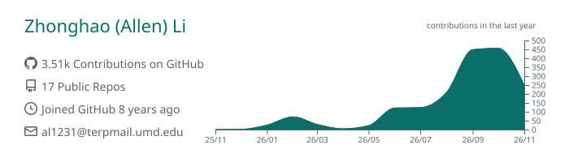
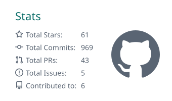
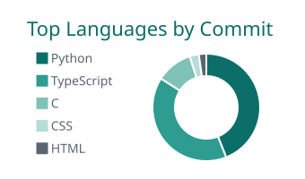

## Hi, I'm Allen (Zhonghao Li)

I'm a PhD student in Information Systems at the University of Maryland, advised by Kunpeng Zhang. I make retrieval-augmented generation (RAG) faster and more accurate on questions that need several pieces of evidence. Before my PhD, I spent four years in Shanghai building fraud and credit-risk models for payments and banking.

**Website:** [allen-li1231.github.io](https://allen-li1231.github.io) · **Scholar:** [Google Scholar](https://scholar.google.com/citations?hl=en&user=RS3xcXUAAAAJ) · **LinkedIn:** [li-zhonghao-allen](https://www.linkedin.com/in/li-zhonghao-allen-0968b8179/) · **Email:** al1231@terpmail.umd.edu

### Research code

| Project | What it does | Links |
| --- | --- | --- |
| **TreeHop** | A 0.18B-parameter model that builds the next hop's query embedding directly, replacing LLM query rewriting in multi-hop retrieval. Cuts retrieval latency by 92.8–97.8%. | [Paper](https://arxiv.org/abs/2504.20114) · [Code](https://github.com/allen-li1231/TreeHop-RAG) · [Model](https://huggingface.co/allen-li1231/treehop-rag) |
| **Refiner** (Findings of EMNLP 2024) | A 7B model that extracts and restructures retrieved passages before they reach the reader LLM. Uses 80.5% fewer input tokens while improving multi-hop QA accuracy by 1.6–7.0%. | [Paper](https://aclanthology.org/2024.findings-emnlp.500/) · [Code](https://github.com/allen-li1231/refiner-rag) · [Model](https://huggingface.co/al1231/Refiner-7B) |

Also accepted: *Beyond Similarity: Complementary Retrieval for Efficient Multi-Hop Retrieval-Augmented Generation* (CoRe), EACL 2027. The full list is on [my website](https://allen-li1231.github.io/#publications).

### Open source

- **[Zeppelin for VS Code](https://github.com/allen-li1231/zeppelin-vscode)**: runs Apache Zeppelin notebooks inside VS Code, so data scientists can work in SQL, Scala, Python and R without leaving the editor. 3,900+ downloads on the [Marketplace](https://marketplace.visualstudio.com/items?itemName=AllenLi1231.zeppelin-vscode).
- **[twinny](https://github.com/rjmacarthy/twinny)**: contributor to a locally hosted AI code-completion extension for VS Code.
- **[VS Code](https://github.com/microsoft/vscode/pull/205204)**: added the native progress bar for running notebook cells.

### Tools I use

<picture>
  <source media="(prefers-color-scheme: dark)" srcset="https://skillicons.dev/icons?i=python%2Cpytorch%2Cts%2Cjava%2Cc%2Crust%2Cr%2Clatex%2Cgit%2Clinux%2Cvscode&amp;perline=11&amp;theme=dark">
  
</picture>

PyTorch · Hugging Face Transformers · PEFT/LoRA · DeepSpeed · vLLM · FAISS · DGL · Spark · SQL · TypeScript

### GitHub activity

<picture>
  <source media="(prefers-color-scheme: dark)" srcset="https://raw.githubusercontent.com/allen-li1231/allen-li1231/output/cards/dark/0-profile-details.svg">
  
</picture>

<picture>
  <source media="(prefers-color-scheme: dark)" srcset="https://raw.githubusercontent.com/allen-li1231/allen-li1231/output/cards/dark/3-stats.svg">
  
</picture>
<picture>
  <source media="(prefers-color-scheme: dark)" srcset="https://raw.githubusercontent.com/allen-li1231/allen-li1231/output/cards/dark/2-most-commit-language.svg">
  
</picture>

<picture>
  <source media="(prefers-color-scheme: dark)" srcset="https://streak-stats.demolab.com/?user=allen-li1231&amp;hide_border=true&amp;background=00000000&amp;ring=4EC1B5&amp;fire=4EC1B5&amp;currStreakLabel=4EC1B5&amp;currStreakNum=E6EDF3&amp;sideNums=E6EDF3&amp;sideLabels=9AA6B0&amp;dates=9AA6B0&amp;stroke=9AA6B0">
  
</picture>

<picture>
  <source media="(prefers-color-scheme: dark)" srcset="https://raw.githubusercontent.com/allen-li1231/allen-li1231/output/github-snake-dark.svg">
  
</picture>
